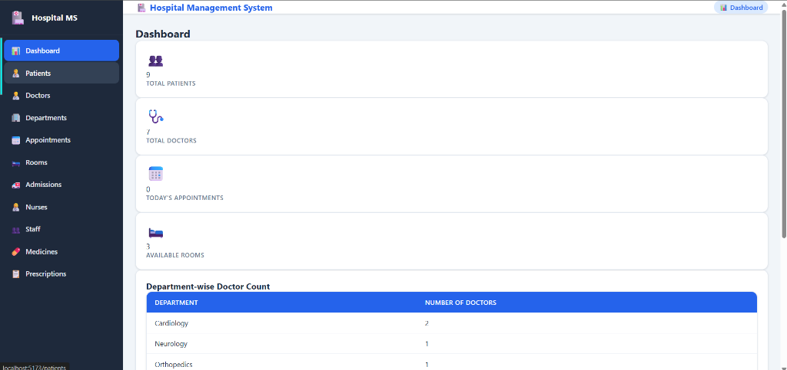
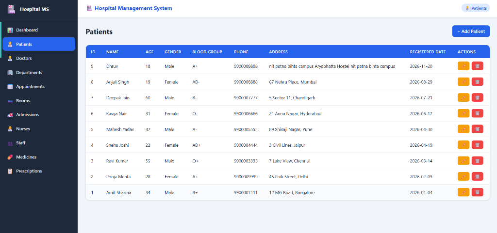
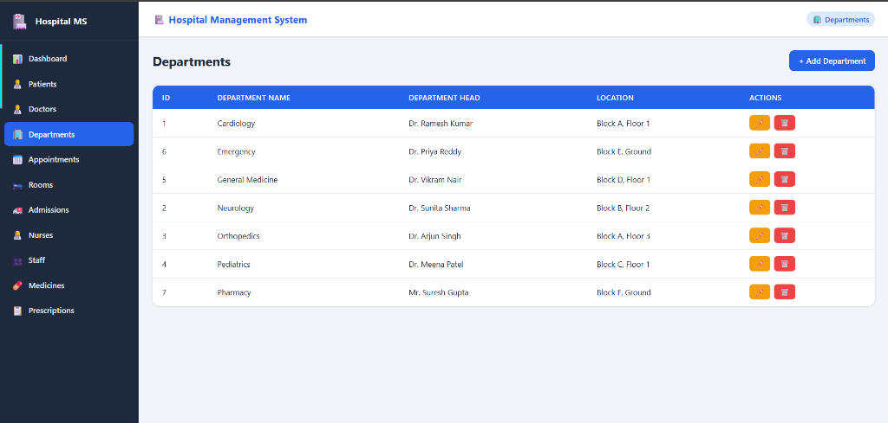
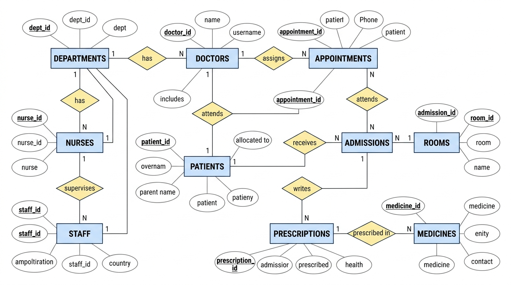
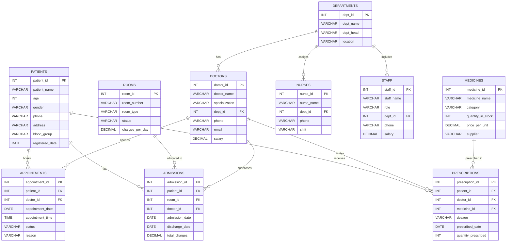

# 🏥 Hospital Management System

A full-stack hospital management application built around a **MySQL relational database**. It unifies patient records, doctors, appointments, admissions, room allocation, nursing staff, general staff, medicine inventory, and prescriptions into a single web interface.

<p align="center">
  <a href="https://hospital-database-pink.vercel.app/"><strong>🌐 Live Demo</strong></a>
  &nbsp;·&nbsp;
  <a href="https://github.com/Dhruvjain2207/hospital-database"><strong>📦 Source Code</strong></a>
  &nbsp;·&nbsp;
  <a href="./hospital.sql"><strong>🗄️ SQL Schema &amp; Sample Data</strong></a>
</p>

<p align="center">
  
  
  
  
  
</p>

---

## 📑 Table of Contents

1. [Overview](#-overview)
2. [Screenshots](#-screenshots)
3. [Features](#-features)
4. [Tech Stack](#-tech-stack)
5. [Complete Database Flow](#-complete-database-flow)
   - [How Data Flows Through the System](#how-data-flows-through-the-system)
   - [ER Diagram — Classic Rectangle / Circle Style](#er-diagram--classic-rectangle--circle-style)
   - [ER Diagram — Entity Relationship (Mermaid)](#er-diagram--entity-relationship-mermaid)
   - [Tables at a Glance](#tables-at-a-glance)
   - [Column-Level Schema Reference](#column-level-schema-reference)
   - [Relationship Summary](#relationship-summary)
5. [Project Structure](#-project-structure)
6. [Getting Started](#-getting-started)
7. [API Overview](#-api-overview)
8. [SQL Concepts Demonstrated](#-sql-concepts-demonstrated)
9. [Learning Outcomes](#-learning-outcomes)
10. [Possible Improvements](#-possible-improvements)
11. [Author](#-author)

---

## ✨ Overview

The system demonstrates how a **relational database** supports the day-to-day information needs of a hospital. The React frontend provides dedicated management screens; an Express REST API communicates with MySQL through the `mysql2` driver.

It is also a practical DBMS project demonstrating relational schema design, primary keys, foreign keys, constraints, joins, aggregate functions, grouping, and full CRUD operations.

---

## 📸 Screenshots

| Dashboard | Patients |
|---|---|
|  |  |

| Departments |
|---|
|  |

---

## 🚀 Features

| Module | Capabilities |
|---|---|
| **Dashboard** | Hospital overview, summary counts, department-wise doctor statistics, appointment status breakdown |
| **Patients** | Register, view, update and delete patient records |
| **Doctors** | Manage doctor profiles, specializations and department assignments |
| **Departments** | Manage department names, heads and locations |
| **Appointments** | Manage patient–doctor bookings, date, time, reason and status |
| **Rooms** | Track room numbers, categories, availability and daily charges |
| **Admissions** | Record admissions, assigned rooms, attending doctors and discharge details |
| **Nurses** | Manage nurse profiles, departments and shifts |
| **Staff** | Manage staff members, roles, departments and salary details |
| **Medicines** | Maintain medicine catalogue, suppliers, pricing and stock levels |
| **Prescriptions** | Associate patients, doctors and medicines with dosage and quantity |

---

## 🧰 Tech Stack

| Layer | Technologies |
|---|---|
| **Frontend** | React 18, Vite 5, React Router DOM |
| **API communication** | Axios |
| **Backend** | Node.js 18+, Express.js 4 |
| **Database** | MySQL 8 |
| **MySQL driver** | mysql2 |
| **Configuration** | dotenv |

---

## 🗺️ Complete Database Flow

### How Data Flows Through the System

The diagram below shows the complete end-to-end path from the user's browser all the way into MySQL and back.

```
┌──────────────────────────────────────────────────────────────────────┐
│                        BROWSER (React 18 + Vite)                      │
│                                                                        │
│   User fills a form  ──▶  Axios HTTP request  ──▶  /api/...           │
│   Page re-renders   ◀──  JSON response        ◀──  Express handler     │
└─────────────────────────────────┬────────────────────────────────────┘
                                  │  HTTP  (port 5173 → proxy → 5000)
                                  ▼
┌──────────────────────────────────────────────────────────────────────┐
│                       EXPRESS REST API (Node.js)                       │
│                                                                        │
│  Route handler  ──▶  mysql2 connection pool  ──▶  SQL query            │
│  JSON response  ◀──  Result rows / insertId  ◀──  MySQL executes       │
└─────────────────────────────────┬────────────────────────────────────┘
                                  │  TCP  (port 3306)
                                  ▼
┌──────────────────────────────────────────────────────────────────────┐
│                     MySQL 8  —  hospital_db                            │
│                                                                        │
│  departments  ◀──▶  doctors  ◀──▶  appointments  ◀──▶  patients        │
│  departments  ◀──▶  nurses                                             │
│  departments  ◀──▶  staff                                              │
│  patients     ◀──▶  admissions  ◀──▶  rooms                            │
│  admissions   ◀──▶  doctors                                            │
│  patients     ◀──▶  prescriptions  ◀──▶  medicines                     │
│  prescriptions◀──▶  doctors                                            │
└──────────────────────────────────────────────────────────────────────┘
```

**Step-by-step flow for a typical operation (e.g. booking an appointment):**

1. **User** opens the Appointments page in the browser.
2. **React** sends `GET /api/appointments` via Axios → Express queries MySQL → returns JSON rows → React renders the table.
3. **User** submits the "New Appointment" form.
4. **React** sends `POST /api/appointments` with JSON body `{ patient_id, doctor_id, appointment_date, … }`.
5. **Express** handler validates the body, runs `INSERT INTO appointments (…) VALUES (?)` via `mysql2`.
6. **MySQL** enforces the `FOREIGN KEY` constraints (patient and doctor must already exist), assigns an `AUTO_INCREMENT` `appointment_id`, and returns `insertId`.
7. **Express** responds `201 Created` with `{ appointment_id }`.
8. **React** refreshes the appointments list automatically.

The same pattern (GET → list, POST → create, PUT → update, DELETE → remove) applies to every module.

---

### ER Diagram — Classic Rectangle / Circle Style

> [!NOTE]
> In classic ER notation **rectangles = entities**, **ellipses/circles = attributes**, **diamonds = relationships**, **underlined attribute = primary key**, **dashed ellipse = derived attribute**.




**Cardinalities at a glance:**

| Relationship | Type | Meaning |
|---|---|---|
| DEPARTMENTS → DOCTORS | 1 : N | One department has many doctors |
| DEPARTMENTS → NURSES | 1 : N | One department assigns many nurses |
| DEPARTMENTS → STAFF | 1 : N | One department includes many staff |
| PATIENTS → APPOINTMENTS | 1 : N | One patient books many appointments |
| DOCTORS → APPOINTMENTS | 1 : N | One doctor attends many appointments |
| PATIENTS → ADMISSIONS | 1 : N | One patient has many admission records |
| ROOMS → ADMISSIONS | 1 : N | One room can be allocated across multiple admissions (over time) |
| DOCTORS → ADMISSIONS | 1 : N | One doctor supervises many admissions |
| PATIENTS → PRESCRIPTIONS | 1 : N | One patient receives many prescriptions |
| DOCTORS → PRESCRIPTIONS | 1 : N | One doctor writes many prescriptions |
| MEDICINES → PRESCRIPTIONS | 1 : N | One medicine appears in many prescriptions |

---

### ER Diagram — Entity Relationship (Mermaid)

> [!NOTE]
> GitHub renders Mermaid diagrams natively — the diagram below appears directly in this README.



---

### Tables at a Glance

| Table | Primary Key | Foreign Keys | Purpose |
|---|---|---|---|
| `departments` | `dept_id` | — | Hospital departments (Cardiology, Neurology, …) |
| `doctors` | `doctor_id` | `dept_id → departments` | Doctors and their specializations |
| `patients` | `patient_id` | — | Patient registration and demographic info |
| `appointments` | `appointment_id` | `patient_id → patients`, `doctor_id → doctors` | Patient–doctor appointment bookings |
| `rooms` | `room_id` | — | Room inventory, type, and availability |
| `admissions` | `admission_id` | `patient_id → patients`, `room_id → rooms`, `doctor_id → doctors` | In-patient admission records |
| `nurses` | `nurse_id` | `dept_id → departments` | Nursing staff and shift assignments |
| `staff` | `staff_id` | `dept_id → departments` | Non-medical hospital employees |
| `medicines` | `medicine_id` | — | Medicine catalogue and stock inventory |
| `prescriptions` | `prescription_id` | `patient_id → patients`, `doctor_id → doctors`, `medicine_id → medicines` | Medicines prescribed to patients |

---

### Column-Level Schema Reference

<details>
<summary><strong>departments</strong></summary>

| Column | Type | Constraints | Description |
|---|---|---|---|
| `dept_id` | INT | PK, AUTO_INCREMENT, NOT NULL | Unique department ID |
| `dept_name` | VARCHAR(100) | NOT NULL | Department name (e.g. Cardiology) |
| `dept_head` | VARCHAR(100) | | Name of the department head |
| `location` | VARCHAR(100) | | Physical location within the hospital |

</details>

<details>
<summary><strong>doctors</strong></summary>

| Column | Type | Constraints | Description |
|---|---|---|---|
| `doctor_id` | INT | PK, AUTO_INCREMENT, NOT NULL | Unique doctor ID |
| `doctor_name` | VARCHAR(100) | NOT NULL | Full name |
| `specialization` | VARCHAR(100) | NOT NULL | Medical specialization |
| `dept_id` | INT | FK → departments | Assigned department |
| `phone` | VARCHAR(15) | | Contact number |
| `email` | VARCHAR(100) | | Email address |
| `salary` | DECIMAL(10,2) | | Monthly salary |

</details>

<details>
<summary><strong>patients</strong></summary>

| Column | Type | Constraints | Description |
|---|---|---|---|
| `patient_id` | INT | PK, AUTO_INCREMENT, NOT NULL | Unique patient ID |
| `patient_name` | VARCHAR(100) | NOT NULL | Full name |
| `age` | INT | NOT NULL | Age in years |
| `gender` | VARCHAR(10) | NOT NULL | Gender |
| `phone` | VARCHAR(15) | | Contact number |
| `address` | VARCHAR(255) | | Residential address |
| `blood_group` | VARCHAR(5) | | Blood group (e.g. B+) |
| `registered_date` | DATE | | Date of registration |

</details>

<details>
<summary><strong>appointments</strong></summary>

| Column | Type | Constraints | Description |
|---|---|---|---|
| `appointment_id` | INT | PK, AUTO_INCREMENT, NOT NULL | Unique appointment ID |
| `patient_id` | INT | FK → patients | Patient who booked |
| `doctor_id` | INT | FK → doctors | Doctor assigned |
| `appointment_date` | DATE | NOT NULL | Date of appointment |
| `appointment_time` | TIME | | Time of appointment |
| `status` | VARCHAR(20) | DEFAULT 'Scheduled' | Scheduled / Completed / Cancelled |
| `reason` | VARCHAR(255) | | Reason for visit |

</details>

<details>
<summary><strong>rooms</strong></summary>

| Column | Type | Constraints | Description |
|---|---|---|---|
| `room_id` | INT | PK, AUTO_INCREMENT, NOT NULL | Unique room ID |
| `room_number` | VARCHAR(10) | NOT NULL | Room number (e.g. 101) |
| `room_type` | VARCHAR(50) | NOT NULL | General Ward / Private / ICU / Semi-Private |
| `status` | VARCHAR(20) | DEFAULT 'Available' | Available / Occupied |
| `charges_per_day` | DECIMAL(8,2) | | Daily room charge in ₹ |

</details>

<details>
<summary><strong>admissions</strong></summary>

| Column | Type | Constraints | Description |
|---|---|---|---|
| `admission_id` | INT | PK, AUTO_INCREMENT, NOT NULL | Unique admission ID |
| `patient_id` | INT | FK → patients | Admitted patient |
| `room_id` | INT | FK → rooms | Allocated room |
| `doctor_id` | INT | FK → doctors | Attending/supervising doctor |
| `admission_date` | DATE | NOT NULL | Date admitted |
| `discharge_date` | DATE | | Date discharged (NULL = still admitted) |
| `total_charges` | DECIMAL(10,2) | | Total billing amount |

</details>

<details>
<summary><strong>nurses</strong></summary>

| Column | Type | Constraints | Description |
|---|---|---|---|
| `nurse_id` | INT | PK, AUTO_INCREMENT, NOT NULL | Unique nurse ID |
| `nurse_name` | VARCHAR(100) | NOT NULL | Full name |
| `dept_id` | INT | FK → departments | Assigned department |
| `phone` | VARCHAR(15) | | Contact number |
| `shift` | VARCHAR(20) | | Morning / Evening / Night |

</details>

<details>
<summary><strong>staff</strong></summary>

| Column | Type | Constraints | Description |
|---|---|---|---|
| `staff_id` | INT | PK, AUTO_INCREMENT, NOT NULL | Unique staff ID |
| `staff_name` | VARCHAR(100) | NOT NULL | Full name |
| `role` | VARCHAR(100) | NOT NULL | Job role (e.g. Pharmacist, Receptionist) |
| `dept_id` | INT | FK → departments | Assigned department |
| `phone` | VARCHAR(15) | | Contact number |
| `salary` | DECIMAL(10,2) | | Monthly salary |

</details>

<details>
<summary><strong>medicines</strong></summary>

| Column | Type | Constraints | Description |
|---|---|---|---|
| `medicine_id` | INT | PK, AUTO_INCREMENT, NOT NULL | Unique medicine ID |
| `medicine_name` | VARCHAR(100) | NOT NULL | Medicine name |
| `category` | VARCHAR(100) | | Category (Analgesic, Antibiotic, …) |
| `quantity_in_stock` | INT | | Current stock count |
| `price_per_unit` | DECIMAL(8,2) | | Price per unit in ₹ |
| `supplier` | VARCHAR(100) | | Supplier name |

</details>

<details>
<summary><strong>prescriptions</strong></summary>

| Column | Type | Constraints | Description |
|---|---|---|---|
| `prescription_id` | INT | PK, AUTO_INCREMENT, NOT NULL | Unique prescription ID |
| `patient_id` | INT | FK → patients | Patient receiving the prescription |
| `doctor_id` | INT | FK → doctors | Doctor who wrote the prescription |
| `medicine_id` | INT | FK → medicines | Medicine prescribed |
| `dosage` | VARCHAR(100) | | Dosage instructions (e.g. 10mg once daily) |
| `prescribed_date` | DATE | NOT NULL | Date the prescription was written |
| `quantity_prescribed` | INT | | Number of units prescribed |

</details>

---

### Relationship Summary

```
DEPARTMENTS  ──has──▶  DOCTORS       (1 department : N doctors)
DEPARTMENTS  ──assigns──▶  NURSES    (1 department : N nurses)
DEPARTMENTS  ──includes──▶  STAFF    (1 department : N staff members)

PATIENTS  ──books──▶  APPOINTMENTS   (1 patient : N appointments)
DOCTORS   ──attends──▶  APPOINTMENTS (1 doctor : N appointments)

PATIENTS  ──has──▶  ADMISSIONS       (1 patient : N admissions)
ROOMS     ──allocated to──▶  ADMISSIONS (1 room : N admissions over time)
DOCTORS   ──supervises──▶  ADMISSIONS  (1 doctor : N admissions)

PATIENTS   ──receives──▶  PRESCRIPTIONS (1 patient : N prescriptions)
DOCTORS    ──writes──▶  PRESCRIPTIONS   (1 doctor : N prescriptions)
MEDICINES  ──prescribed in──▶  PRESCRIPTIONS (1 medicine : N prescription records)
```

**Key design decisions:**

- `DEPARTMENTS` is the **root anchor** entity — doctors, nurses, and staff all reference it.
- `PATIENTS` is the **central patient entity** — appointments, admissions, and prescriptions all trace back to it.
- `PRESCRIPTIONS` is a **ternary relationship table** linking patients, doctors, and medicines in a single row.
- `ADMISSIONS` is also a **ternary relationship table** linking patients, rooms, and doctors.
- A `NULL` `discharge_date` in `admissions` means the patient is **currently admitted**.
- `AUTO_INCREMENT` on every PK ensures unique surrogate keys with no manual ID management.

---

## 📁 Project Structure

```
hospital-database/
├── backend/
│   ├── db.js                 # mysql2 connection pool (reads .env)
│   ├── server.js             # Express app — all REST routes
│   ├── .env                  # Local secrets (not committed)
│   ├── .env.example          # Template for environment variables
│   └── package.json
├── frontend/
│   ├── src/
│   │   ├── pages/            # One page component per module
│   │   ├── api.js            # Axios helper functions for every endpoint
│   │   ├── App.jsx           # React Router setup
│   │   └── main.jsx          # React entry point
│   ├── index.html
│   ├── vite.config.js        # Dev proxy: /api → http://localhost:5000
│   └── package.json
├── hospital.sql              # Full SQL: schema + sample data + example queries
└── README.md
```

---

## ⚙️ Getting Started

### Prerequisites

- **Node.js 18+** and npm
- **MySQL 8** server (local or cloud)
- **MySQL Workbench** (optional, for a GUI)

### 1. Clone the repository

```bash
git clone https://github.com/Dhruvjain2207/hospital-database.git
cd hospital-database
```

### 2. Set up the database

The root-level `hospital.sql` script creates `hospital_db`, all 10 tables, and inserts sample records.

**Using the MySQL CLI:**

```bash
mysql -u root -p < hospital.sql
```

**Using MySQL Workbench:** open `hospital.sql` and click ⚡ Execute.

**Verify:**

```sql
USE hospital_db;
SHOW TABLES;
```

> [!CAUTION]
> The script begins with `DROP DATABASE IF EXISTS hospital_db`. Running it again **deletes all existing data**. Back up anything you need first.

### 3. Configure and start the backend

```bash
cd backend
npm install
```

Create `backend/.env` (copy from `.env.example`):

```env
DB_HOST=localhost
DB_USER=root
DB_PASSWORD=your_mysql_password
DB_NAME=hospital_db
DB_PORT=3306
PORT=5000
```

```bash
npm start
# Express server → http://localhost:5000
```

### 4. Configure and start the frontend

Open a **second terminal**:

```bash
cd frontend
npm install
npm run dev
# Vite dev server → http://localhost:5173
```

> [!IMPORTANT]
> Keep the MySQL server **and** the backend running while using the frontend. Vite proxies all `/api` requests to `http://localhost:5000`.

---

## 🔌 API Overview

All endpoints are prefixed with `/api`.

| Resource | Base Endpoint | Supported Operations |
|---|---|---|
| Patients | `/api/patients` | GET all, GET by ID, POST, PUT by ID, DELETE by ID |
| Doctors | `/api/doctors` | GET all, GET by ID, POST, PUT by ID, DELETE by ID |
| Departments | `/api/departments` | GET all, POST, PUT by ID, DELETE by ID |
| Appointments | `/api/appointments` | GET all, POST, PUT by ID, DELETE by ID |
| Rooms | `/api/rooms` | GET all, GET available, POST, PUT by ID, DELETE by ID |
| Admissions | `/api/admissions` | GET all, POST, PUT by ID, DELETE by ID |
| Nurses | `/api/nurses` | GET all, POST, PUT by ID, DELETE by ID |
| Staff | `/api/staff` | GET all, POST, PUT by ID, DELETE by ID |
| Medicines | `/api/medicines` | GET all, GET low-stock, POST, PUT by ID, DELETE by ID |
| Prescriptions | `/api/prescriptions` | GET all, POST, DELETE by ID |
| Dashboard | `/api/dashboard` | Summary stats, department stats, appointment status |

### Example Requests

**Fetch all patients:**
```http
GET /api/patients
```

**Register a patient:**
```http
POST /api/patients
Content-Type: application/json

{
  "patient_name": "Aarav Sharma",
  "age": 28,
  "gender": "Male",
  "phone": "9876543210",
  "address": "Patna",
  "blood_group": "B+",
  "registered_date": "2026-11-21"
}
```

**Fetch dashboard statistics:**
```http
GET /api/dashboard/stats
```

---

## 🧠 SQL Concepts Demonstrated

### DDL — Schema Definition

```sql
CREATE DATABASE hospital_db;
CREATE TABLE prescriptions (
    prescription_id   INT NOT NULL AUTO_INCREMENT,
    patient_id        INT,
    doctor_id         INT,
    medicine_id       INT,
    PRIMARY KEY (prescription_id),
    FOREIGN KEY (patient_id)  REFERENCES patients(patient_id),
    FOREIGN KEY (doctor_id)   REFERENCES doctors(doctor_id),
    FOREIGN KEY (medicine_id) REFERENCES medicines(medicine_id)
);
```

### DML — CRUD

```sql
-- INSERT
INSERT INTO patients (patient_name, age, gender, blood_group, registered_date)
VALUES ('Amit Sharma', 34, 'Male', 'B+', '2026-01-05');

-- UPDATE
UPDATE appointments SET status = 'Completed' WHERE appointment_id = 3;

-- DELETE
DELETE FROM appointments WHERE appointment_id = 6 AND status = 'Cancelled';
```

### JOIN — Linking Tables

```sql
-- Appointments with patient and doctor names
SELECT
    a.appointment_id,
    p.patient_name,
    d.doctor_name,
    a.appointment_date,
    a.appointment_time,
    a.status
FROM appointments a
JOIN patients p ON a.patient_id = p.patient_id
JOIN doctors  d ON a.doctor_id  = d.doctor_id;
```

```sql
-- Prescription details across 3 tables
SELECT
    p.patient_name,
    d.doctor_name,
    m.medicine_name,
    pr.dosage,
    pr.prescribed_date
FROM prescriptions pr
JOIN patients  p ON pr.patient_id  = p.patient_id
JOIN doctors   d ON pr.doctor_id   = d.doctor_id
JOIN medicines m ON pr.medicine_id = m.medicine_id;
```

### GROUP BY + Aggregates

```sql
-- Doctor count per department
SELECT dept.dept_name, COUNT(d.doctor_id) AS doctor_count
FROM departments dept
LEFT JOIN doctors d ON dept.dept_id = d.dept_id
GROUP BY dept.dept_id, dept.dept_name
ORDER BY doctor_count DESC;

-- Total revenue from completed admissions
SELECT SUM(total_charges) AS total_revenue
FROM admissions
WHERE discharge_date IS NOT NULL;

-- Pharmacy stock value per medicine category
SELECT
    category,
    SUM(quantity_in_stock)                  AS total_units,
    SUM(quantity_in_stock * price_per_unit) AS total_stock_value
FROM medicines
GROUP BY category
ORDER BY total_stock_value DESC;
```

---

## 🎯 Learning Outcomes

This project provides practical experience in:

1. Designing a relational database schema from real-world entities and relationships.
2. Defining primary keys, foreign keys, and constraints (`NOT NULL`, `DEFAULT`, `AUTO_INCREMENT`).
3. Performing CRUD operations using SQL (INSERT, SELECT, UPDATE, DELETE).
4. Retrieving related records using INNER JOIN and LEFT JOIN across multiple tables.
5. Applying aggregate functions (`COUNT`, `SUM`) and `GROUP BY` for dashboard reporting.
6. Connecting a MySQL database to a Node.js REST API using `mysql2`.
7. Integrating REST API endpoints with a React frontend via Axios.
8. Understanding ER modelling — entities, attributes, relationships, and cardinality.

---

## 🔮 Possible Improvements

- **Authentication** — role-based access for administrators, doctors, and staff.
- **Input validation** — server-side validation and centralized error handling.
- **Pagination & search** — filtering, sorting, and pagination for large datasets.
- **Database indexes** — add indexes on FK columns and frequently queried fields.
- **Automated tests** — unit and integration tests for API routes.
- **API documentation** — Swagger / OpenAPI specification.
- **Audit logs** — track changes to critical records (admissions, prescriptions).
- **Transaction handling** — wrap admission + room-status update in a single atomic transaction.

---

## 👨‍💻 Author

**Dhruv Jain**  
B.Tech — Computer Science & Engineering

- **GitHub:** [@Dhruvjain2207](https://github.com/Dhruvjain2207)
- **Repository:** [hospital-database](https://github.com/Dhruvjain2207/hospital-database)
- **Live application:** [Hospital Management System](https://hospital-database-pink.vercel.app/)
