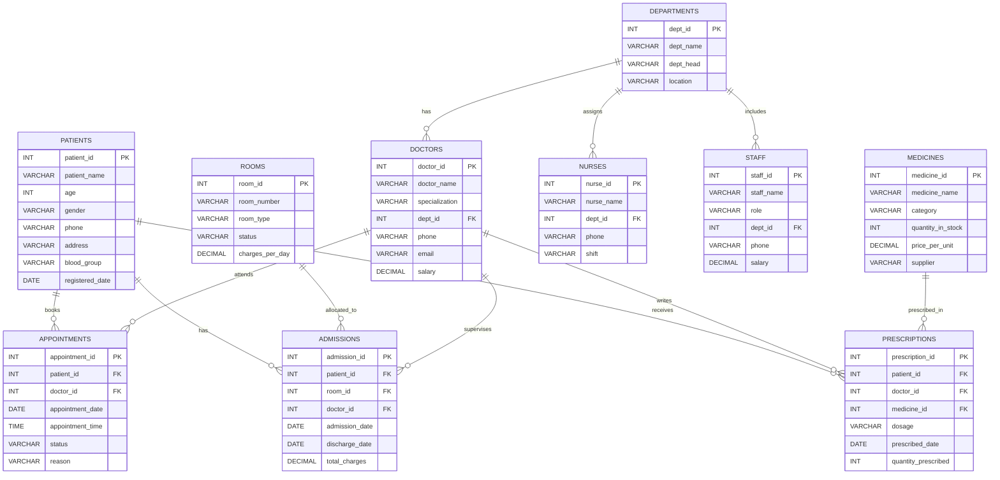

🏥 Hospital Management System
A full-stack hospital management application built around a MySQL relational database. It brings common hospital workflows—patient records, doctors, appointments, admissions, room allocation, staff, medicines and prescriptions—into one web interface.

  <a href="https://hospital-database-pink.vercel.app/"><strong>🌐 Live Demo</strong></a>
  &nbsp; · &nbsp;
  <a href="https://github.com/Dhruvjain2207/hospital-database"><strong>📦 Source Code</strong></a>
  &nbsp; · &nbsp;
  <a href="./hospital.sql"><strong>🗄️ SQL Schema & Sample Data</strong></a>

  
  
  
  
  

✨ Overview
The system demonstrates how a relational database can support the day-to-day information needs of a hospital. The React frontend provides dedicated management screens, while an Express REST API communicates with MySQL through the mysql2 driver.

It is also a practical DBMS project demonstrating relational schema design, primary keys, foreign keys, constraints, joins, aggregate functions, grouping and CRUD operations.
🚀 Features
Module	Capabilities
Dashboard	Hospital overview, summary counts, department-wise doctor statistics and appointment status
Patients	Register, view, update and delete patient records
Doctors	Manage doctor profiles, specializations and department assignments
Departments	Manage department names, heads and locations
Appointments	Manage patient-doctor bookings, date, time, reason and status
Rooms	Track room numbers, categories, availability and daily charges
Admissions	Record admissions, assigned rooms, attending doctors and discharge details
Nurses	Manage nurse profiles, departments and shifts
Staff	Manage staff members, roles, departments and salary details
Medicines	Maintain medicine catalogue, suppliers, pricing and stock levels
Prescriptions	Associate patients, doctors and medicines with dosage and quantity

🧰 Tech Stack
Layer	Technologies
Frontend	React 18, Vite, React Router DOM
API communication	Axios
Backend	Node.js, Express.js
Database	MySQL
MySQL driver	mysql2
Configuration	dotenv

🗺️ Database Design
The hospital_db database contains 10 relational tables. The ER diagram below represents the entities and their foreign-key relationships.
Entity Relationship Diagram
GitHub renders Mermaid diagrams natively, so the ER diagram appears directly in this README.

Tables at a glance
Table	Primary key	Foreign keys	Purpose
departments	dept_id	—	Hospital departments
doctors	doctor_id	dept_id	Doctors and specializations
patients	patient_id	—	Patient information
appointments	appointment_id	patient_id, doctor_id	Appointment bookings
rooms	room_id	—	Room inventory and availability
admissions	admission_id	patient_id, room_id, doctor_id	In-patient admissions
nurses	nurse_id	dept_id	Nursing staff
staff	staff_id	dept_id	Other hospital employees
medicines	medicine_id	—	Medicine inventory
prescriptions	prescription_id	patient_id, doctor_id, medicine_id	Prescribed medicines

Relationship summary
- A department can have multiple doctors, nurses and staff members.
- A patient can book multiple appointments with doctors.
- A patient can have multiple admission records; each admission references a room and a doctor.
- A prescription connects a patient, a doctor and a medicine.
- A medicine can appear in multiple prescription records.
📁 Project Structure
hospital-database/
├── backend/
│   ├── db.js                 # MySQL connection pool
│   ├── server.js             # Express API routes
│   └── package.json
├── frontend/
│   ├── src/
│   │   ├── pages/            # Application pages/modules
│   │   ├── api.js             # Axios API functions
│   │   ├── App.jsx            # Application and routes
│   │   └── main.jsx           # React entry point
│   ├── index.html
│   ├── vite.config.js
│   └── package.json
├── hospital.sql              # Database schema, sample data and SQL queries
└── README.md
⚙️ Getting Started
Prerequisites
- Node.js 18 or later and npm
- MySQL server (or a compatible MySQL database service)
- MySQL Workbench (optional)
1. Clone the repository
git clone https://github.com/Dhruvjain2207/hospital-database.git
cd hospital-database
2. Set up the database
The root-level hospital.sql script creates hospital_db, creates the tables, inserts sample records and includes example SQL queries.

Using the MySQL command-line client:
mysql -u root -p < hospital.sql
Alternatively, open hospital.sql in MySQL Workbench and execute it.

Verify the database:
USE hospital_db;
SHOW TABLES;
Important: If the SQL script contains DROP DATABASE IF EXISTS hospital_db, executing it again will delete and recreate the database, including its data. Back up any data you need before running it.

3. Configure and start the backend
cd backend
npm install
Create a .env file inside the backend directory:
DB_HOST=localhost
DB_USER=root
DB_PASSWORD=your_mysql_password
DB_NAME=hospital_db
DB_PORT=3306
PORT=5000
Replace the values with your own database credentials. Do not commit your .env file or expose database passwords.

Start the API:
npm start
The Express server runs on http://localhost:5000 by default.
4. Configure and start the frontend
Open a second terminal:
cd frontend
npm install
npm run dev
Vite prints the local development URL in the terminal (typically http://localhost:5173).

Keep the database and backend running while using the frontend. Ensure the Vite development proxy/API configuration routes /api requests to the Express server.
🔌 API Overview
The backend exposes REST endpoints under the /api prefix.
Resource	Base endpoint	Supported operations
Patients	/api/patients	GET, GET by ID, POST, PUT by ID, DELETE by ID
Doctors	/api/doctors	GET, GET by ID, POST, PUT by ID, DELETE by ID
Departments	/api/departments	GET, POST, PUT by ID, DELETE by ID
Appointments	/api/appointments	GET, POST, PUT by ID, DELETE by ID
Rooms	/api/rooms	GET, GET available rooms, POST, PUT by ID, DELETE by ID
Admissions	/api/admissions	GET, POST, PUT by ID, DELETE by ID
Nurses	/api/nurses	GET, POST, PUT by ID, DELETE by ID
Staff	/api/staff	GET, POST, PUT by ID, DELETE by ID
Medicines	/api/medicines	GET, GET low-stock medicines, POST, PUT by ID, DELETE by ID
Prescriptions	/api/prescriptions	GET, POST, DELETE by ID
Dashboard	/api/dashboard	Summary statistics, department statistics, appointment status

Example requests
Fetch all patients:
GET /api/patients
Create a patient:
POST /api/patients
Content-Type: application/json

{
  "patient_name": "Aarav Sharma",
  "age": 28,
  "gender": "Male",
  "phone": "9876543210",
  "address": "Patna",
  "blood_group": "B+",
  "registered_date": "2026-11-21"
}
Fetch dashboard statistics:
GET /api/dashboard/stats
🧠 SQL Concepts Demonstrated
The SQL script and backend queries demonstrate:
- DDL: CREATE DATABASE, CREATE TABLE
- Constraints: PRIMARY KEY, FOREIGN KEY, NOT NULL, DEFAULT
- Auto-generated identifiers: AUTO_INCREMENT
- DML: INSERT, UPDATE, DELETE
- Data retrieval: SELECT, WHERE, ORDER BY
- Joins: INNER JOIN, LEFT JOIN
- Aggregate functions: COUNT(), SUM()
- Grouping: GROUP BY
Example: JOIN
Retrieve appointment information along with the associated patient and doctor names:
SELECT
    a.appointment_id,
    p.patient_name,
    d.doctor_name,
    a.appointment_date,
    a.appointment_time,
    a.status
FROM appointments AS a
JOIN patients AS p ON a.patient_id = p.patient_id
JOIN doctors AS d ON a.doctor_id = d.doctor_id;
Example: GROUP BY
Count the doctors assigned to each department:
SELECT
    dept.dept_name,
    COUNT(d.doctor_id) AS doctor_count
FROM departments AS dept
LEFT JOIN doctors AS d ON dept.dept_id = d.dept_id
GROUP BY dept.dept_id, dept.dept_name;
🎯 Learning Outcomes
This project provides practical experience in:
1. Designing a relational database schema from real-world entities.
2. Defining primary keys and foreign-key relationships.
3. Performing CRUD operations using SQL.
4. Retrieving related records using joins.
5. Applying aggregate functions and grouping for reports.
6. Connecting a MySQL database to a backend REST API.
7. Integrating API endpoints with a React frontend.
🔮 Possible Improvements
- Authentication and role-based access for administrators, doctors and staff.
- Server-side input validation and centralized error handling.
- Pagination, filtering and search for larger datasets.
- Database indexes based on query patterns.
- Automated tests and API documentation.
- Audit logs and transaction handling for admission and room-allocation workflows.
👨‍💻 Author
Dhruv Jain
B.Tech — Computer Science & Engineering
- GitHub: @Dhruvjain2207
- Repository: hospital-database
- Live application: Hospital Management System
